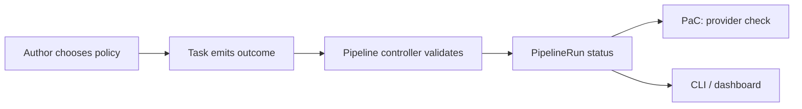
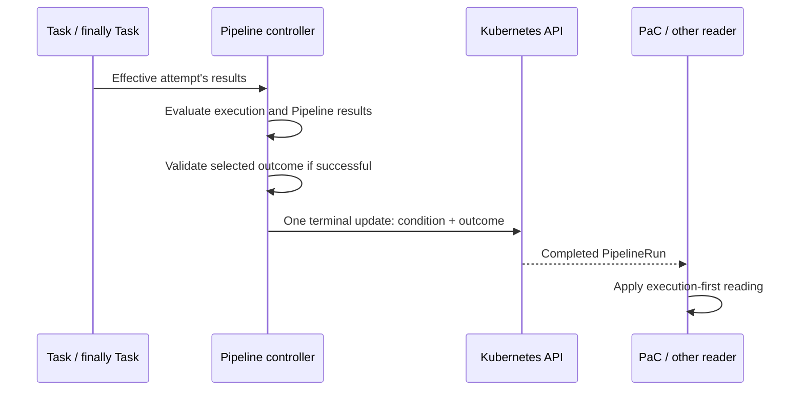

# TEP-0171: Author-defined PipelineRun outcomes

<!-- toc -->
- [Summary](#summary)
- [Motivation](#motivation)
  - [Scope](#scope)
- [Proposal](#proposal)
- [Design Details](#design-details)
  - [Authoring API](#authoring-api)
  - [Consumer API and Precedence](#consumer-api-and-precedence)
  - [Expected User Experience](#expected-user-experience)
  - [Publication](#publication)
- [Design Evaluation](#design-evaluation)
- [Alternatives and Open Questions](#alternatives-and-open-questions)
- [Implementation Plan](#implementation-plan)
- [References](#references)
<!-- /toc -->

## Summary

Let Pipeline authors report `Neutral` when execution succeeds with findings.
The diagram shows how the author's decision reaches PaC and other readers
through PipelineRun status:



## Motivation

A successful validation Task can warn that a release prerequisite is missing.
When the warning stays in logs, a user can miss it and encounter a later release
failure. Publishing a neutral outcome makes the finding visible to consumers.

### Scope

The author decides what a finding means. Pipeline publishes that decision;
PaC handles provider presentation.

| Included | Separate follow-ups |
| --- | --- |
| Neutral outcome and optional message. | Other outcomes, TaskRun reporting, and pause/resume. |
| Shared PipelineRun API for consumers. | Task annotations and scan/test report formats. |

## Proposal

Add `PipelineSpec.outcome.result` to select one existing object-valued Pipeline
result. On successful completion, copy its validated `reason` and `message` into
the new `PipelineRun.status.outcome` field.

| Status field | Meaning |
| --- | --- |
| `status.conditions` | Execution state, owned by the controller. |
| `status.outcome` | Author-selected report, validated and written by the controller. |

Preserve execution conditions, reasons, messages, and timestamps. In particular,
neutral is terminal execution success, never `Succeeded=Unknown`. Existing
readers keep their execution-based view until they adopt the new field.

## Design Details

### Authoring API

The selector is a literal Pipeline result name. It works in a Pipeline or an
embedded `pipelineSpec`; referenced Pipelines supply their own selector.

Consider a release whose version is missing from its catalog. The validation
check runs successfully and reports the finding. The author wants the run to
finish with a neutral report and a message asking the release engineer to review.

Read the spec through these four fields:

| Field | Role in the example |
| --- | --- |
| `tasks.validate-release` | Checks whether the release version exists in the supplied catalog inventory. |
| `finally.report-outcome` | Applies the author's policy: a finding becomes `Neutral`; otherwise `Succeeded`. |
| `results.workflow-outcome` | Exposes the reporting Task's object result as a Pipeline result. |
| `outcome.result` | Selects that Pipeline result for publication in `status.outcome`. |

Complete example using the proposed API, which requires controller support.
The catalog inventory is inline to keep the validation check self-contained:

```yaml
apiVersion: tekton.dev/v1
kind: PipelineRun
metadata:
  generateName: release-validation-
spec:
  pipelineSpec:
    outcome:
      result: workflow-outcome
    results:
      - name: workflow-outcome
        type: object
        description: The author's overall validation outcome.
        value: $(finally.report-outcome.results.outcome[*])
    tasks:
      - name: validate-release
        taskSpec:
          results:
            - name: finding
              type: string
          steps:
            - name: check-catalog
              image: alpine:3.22
              env:
                - name: RELEASE_VERSION
                  value: "1.4.0"
                - name: CATALOG_VERSIONS
                  value: |
                    1.2.0
                    1.3.0
              script: |
                #!/bin/sh
                set -eu
                if printf '%s\n' "$CATALOG_VERSIONS" |
                  grep -Fqx -- "$RELEASE_VERSION"; then
                  finding=false
                else
                  finding=true
                fi
                printf '%s' "$finding" > "$(results.finding.path)"
    finally:
      - name: report-outcome
        params:
          - name: finding
            value: $(tasks.validate-release.results.finding)
        taskSpec:
          params:
            - name: finding
              type: string
          results:
            - name: outcome
              type: object
              properties:
                reason:
                  type: string
                message:
                  type: string
          steps:
            - name: report
              image: alpine:3.22
              env:
                - name: FINDING
                  value: $(params.finding)
              script: |
                #!/bin/sh
                set -eu
                if [ "$FINDING" = true ]; then
                  printf '%s' \
                    '{"reason":"Neutral","message":"Release version missing from catalog; review before releasing."}' \
                    > "$(results.outcome.path)"
                else
                  printf '%s' '{"reason":"Succeeded","message":""}' \
                    > "$(results.outcome.path)"
                fi
```

Both Tasks exit successfully. The reporting Task expresses the business outcome;
it does not manufacture an execution failure.

| Report field | Proposed contract |
| --- | --- |
| `reason` | Required string: `Succeeded` or `Neutral`. |
| `message` | Optional plain text; maximum 4,096 UTF-8 bytes. |
| Other keys | Rejected for this selected result. |

No selector means unchanged behavior. A selector must name a declared object
result. No new expression language, reserved result name, file protocol, or
status-write permission is introduced.

### Consumer API and Precedence

Read execution first, then the outcome. Existing failure and `onError` rules
remain authoritative; successful runs with skipped Tasks keep reason `Completed`.

| Execution | Selected report | Behavior |
| --- | --- | --- |
| Running | Any | Keep the running state; no published outcome. |
| Failed, cancelled, timed out, or result processing failed | Any | Preserve the failure; no published outcome. |
| Successful | No selector | Keep existing success behavior. |
| Successful | Valid `Succeeded` | Publish the report; consumers show success. |
| Successful | Valid `Neutral` | Publish the report; consumers show neutral and its message. |
| Otherwise successful | Missing or invalid | Fail with reason `InvalidPipelineOutcome`; no published outcome. |

For the example above, the controller preserves successful execution and
publishes the author's neutral report:

```yaml
status:
  conditions:
    - type: Succeeded
      status: "True"
      reason: Succeeded
  outcome:
    reason: Neutral
    message: "Release version missing from catalog; review before releasing."
```

Missing includes a selected result whose producer was skipped. Invalid includes
wrong types, unknown keys or reasons, and oversized messages. This proposed
failure applies only to opted-in, otherwise successful runs; it never replaces
an existing execution or result-processing failure.

PaC maps neutral to a provider conclusion where supported. Otherwise it must
document its mapping and surface the message. Consumers escape untrusted text;
unknown future reasons retain execution-based handling and display the report.

### Expected User Experience

The release engineer can see the finding without searching logs:

| Surface | Expected interpretation |
| --- | --- |
| TaskRuns | Both succeeded: validation and reporting executed correctly. |
| PipelineRun | Execution succeeded; `status.outcome.reason` is `Neutral`. |
| PaC, on a provider supporting neutral | Neutral conclusion with "Release version missing from catalog; review before releasing." |
| Adopting CLI or dashboard | Successful execution with the same finding and message. |

Add `1.4.0` to `CATALOG_VERSIONS` and the same spec reports `Succeeded`.
If validation fails to execute, that execution failure takes precedence over
any neutral report. A `finally` Task still follows existing dependency and
scheduling rules, and object-result feature requirements continue to apply.

### Publication

The sequence below shows why the outcome and terminal condition must be
published together: PaC must observe the final report in its first completion
event.



Reuse existing result collection. Retries, restarts, and repeated reconciliation
must produce the same effective outcome; abandoned attempts cannot supply it.

The controller implements the spec in this order:

1. Resolve the Pipeline spec and validate that `outcome.result` selects a
   declared object result.
2. Collect Task results and evaluate Pipeline results through the existing path,
   including the result from `finally.report-outcome`.
3. Preserve any execution or result-processing failure. Otherwise, at successful
   completion, validate the selected report's reason, message, and size.
4. Persist the final condition and outcome together. Consumers then apply the
   execution-first rules above.

## Design Evaluation

The API adds a small result validation step without requiring another Pod,
service, or API request. Authors may add a summary Task when aggregation is needed.

| Concern | Contract |
| --- | --- |
| Compatibility | Keep existing execution semantics; see [TEP-0151]. |
| Hidden findings | Missing selected reports fail visibly. |
| Security | No extra RBAC; escape messages and omit secrets. |
| Adoption | PaC, CLI, and dashboard must explicitly read the new field. |

## Alternatives and Open Questions

This draft prefers an additive outcome to preserve existing reasons. The status
representation remains open:

| Representation | Trade-off |
| --- | --- |
| `status.outcome` (proposed) | Preserves execution conditions; consumers must read the new field. |
| `reason: Neutral` on the `Succeeded` condition | Reuses existing fields but changes the successful reason vocabulary. |
| Separate condition | Requires defined boolean and absence semantics. |

Other decisions and alternatives:

| Decision | Proposed answer / alternative |
| --- | --- |
| Producer API | Select an object result / bind reason and message directly. |
| Missing or invalid report | Fail visibly / define another visible error. |
| Names and bounds | Review enum, field names, and 4,096-byte message limit. |
| PaC-only interpretation | Avoid divergent meaning across consumers. |
| Direct status patch / special exit code | Avoid competing writers and mixing policy with process failure. |
| Annotations alone | Useful detail, but do not define a shared run outcome. |

## Implementation Plan

Roll out the feature in this order; no implementation PR exists yet:

1. Agree the API shape and precedence rules.
2. Add API types, generated CRDs, validation, controller support, and docs behind
   a dedicated, disabled-by-default alpha flag.
3. Verify Pipeline and consumer behavior using the checks below.
4. Upgrade consumers before authors opt their Pipelines in.
5. Evaluate graduation using adoption feedback.

| Check | Required evidence |
| --- | --- |
| Compatibility and gate | No selector is unchanged; disabled feature rejects opt-in. |
| Validation | Embedded/resolved specs; types, enum, bounds, unknown keys, missing/skipped producer. |
| Precedence | Failures, cancellation, timeouts, final Tasks, ignored failures, skipped Tasks. |
| Publication | Effective retry results; one terminal update; restart/reconcile consistency. |
| End to end | Successful Tasks report neutral; PaC and another reader agree; also test success and conflicting failure. |

Test using existing Pipeline and PaC infrastructure. For downgrade, remove
selectors and finish opted-in runs before replacing the controller. Further
outcomes and TaskRun reporting require follow-up proposals.

## References

- [PaC #1235][pac-results]: related discussion.
- [TEP process][tep-process] and [finally result propagation][TEP-0116].
- [Compatibility policy][compatibility] and [TEP-0151].
- [Pipeline results][pipeline-results] and [feature versioning][feature-versioning].
- Verified upstream [completion helpers][status-source] and [status publication][reconciler-source].

[pac-results]: https://github.com/tektoncd/pipelines-as-code/issues/1235
[tep-process]: https://github.com/tektoncd/community/blob/main/teps/0001-tekton-enhancement-proposal-process.md
[TEP-0116]: https://github.com/tektoncd/community/blob/main/teps/0116-referencing-finally-task-results-in-pipeline-results.md
[TEP-0151]: https://github.com/tektoncd/community/blob/main/teps/0151-error-attribution-via-condition-status.md
[compatibility]: https://github.com/tektoncd/pipeline/blob/main/api_compatibility_policy.md
[pipeline-results]: https://github.com/tektoncd/pipeline/blob/main/docs/pipelines.md#emitting-results-from-a-pipeline
[feature-versioning]: https://github.com/tektoncd/pipeline/blob/main/docs/developers/feature-versioning.md
[status-source]: https://github.com/tektoncd/pipeline/blob/2451916543955b4525bcafb09b3b3efde4cf0c6f/pkg/apis/pipeline/v1/pipelinerun_types.go#L78-L95
[reconciler-source]: https://github.com/tektoncd/pipeline/blob/2451916543955b4525bcafb09b3b3efde4cf0c6f/pkg/reconciler/pipelinerun/pipelinerun.go#L976-L1010
