# TEP-0197: Author-defined PipelineRun outcomes

Proposed API for `tektoncd/pipeline`. API choices below need upstream review.

<!-- toc -->
- [Summary](#summary)
- [Motivation](#motivation)
  - [Scope](#scope)
- [Proposal](#proposal)
- [Design Details](#design-details)
  - [Authoring API](#authoring-api)
  - [Consumer API and Precedence](#consumer-api-and-precedence)
  - [Reporting Example](#reporting-example)
  - [Publication](#publication)
- [Design Evaluation](#design-evaluation)
- [Alternatives and Open Questions](#alternatives-and-open-questions)
- [Implementation Plan](#implementation-plan)
- [References](#references)
<!-- /toc -->

## Summary

Let Pipeline authors report a neutral outcome when execution succeeds with
findings. Publish it in PipelineRun status so PaC and other readers share one
interpretation.

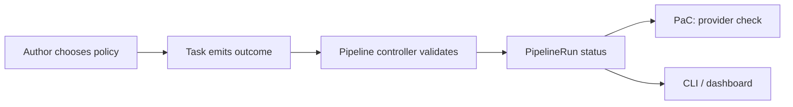

## Motivation

A successful validation Task can warn that a release prerequisite is missing.
The November 5, 2026 discussion asked for that finding to be visible beyond logs.

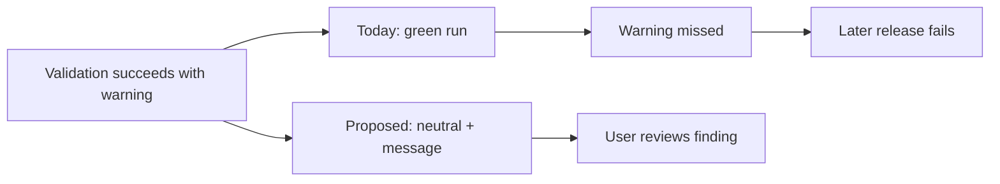

### Scope

The author decides what a finding means. Pipeline publishes that decision;
PaC handles provider presentation.

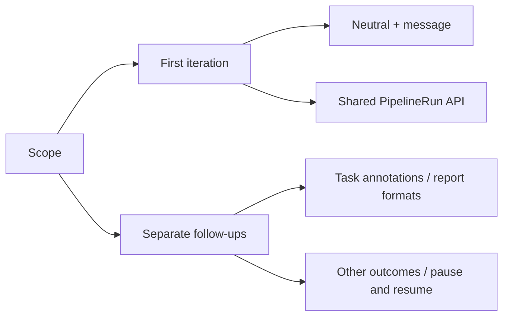

## Proposal

Add `PipelineSpec.outcome.result` to select one existing object-valued Pipeline
result. On successful completion, copy its validated `reason` and `message` into
the new `PipelineRun.status.outcome` field.

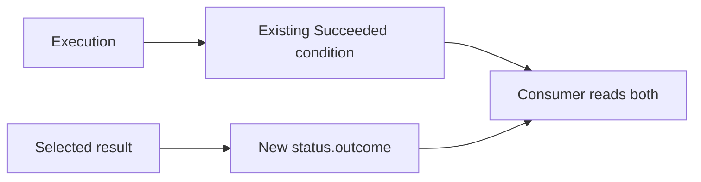

Preserve execution conditions, reasons, messages, and timestamps. In particular,
neutral is terminal execution success, never `Succeeded=Unknown`. Existing
readers keep their execution-based view until they adopt the new field.

## Design Details

### Authoring API

The selector is a literal Pipeline result name. It works in a Pipeline or an
embedded `pipelineSpec`; referenced Pipelines supply their own selector.

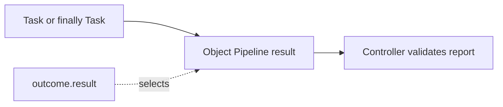

API excerpt; `report-outcome` is an author-supplied Task:

```yaml
spec:
  outcome:
    result: workflow-outcome
  results:
    - name: workflow-outcome
      type: object
      description: The author's outcome.
      value: $(finally.report-outcome.results.outcome[*])
```

| Report field | Proposed contract |
| --- | --- |
| `reason` | Required string: `Succeeded` or `Neutral`. |
| `message` | Optional plain text; maximum 4,096 UTF-8 bytes. |
| Other keys | Rejected for this selected result. |

No selector means unchanged behavior. A selector must name a declared object
result. No new expression language, reserved result name, file protocol, or
status-write permission is introduced.

### Consumer API and Precedence

Read execution first, then the outcome. Existing failure and `onError` rules
remain authoritative; successful runs with skipped Tasks keep reason `Completed`.

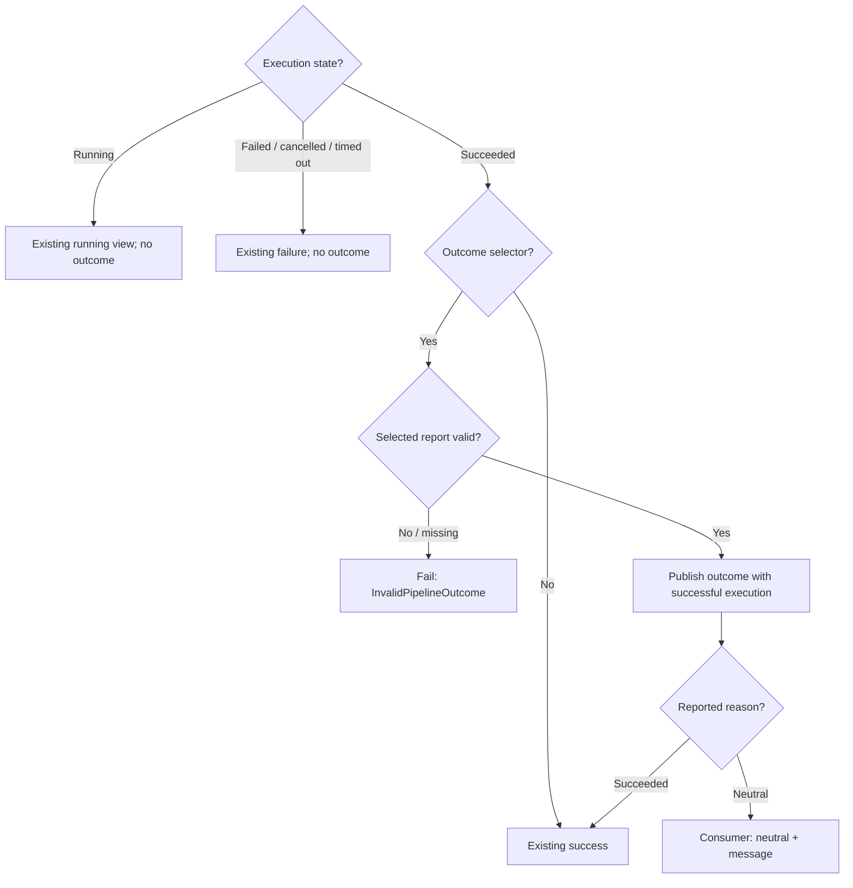

Example status:

```yaml
status:
  conditions:
    - type: Succeeded
      status: "True"
      reason: Succeeded
  outcome:
    reason: Neutral
    message: "Review validation output before releasing."
```

Missing includes a selected result whose producer was skipped. Invalid includes
wrong types, unknown keys or reasons, and oversized messages. This proposed
failure applies only to opted-in, otherwise successful runs; it never replaces
an existing execution or result-processing failure.

PaC maps neutral to a provider conclusion where supported. Otherwise it must
document its mapping and surface the message. Consumers escape untrusted text;
unknown future reasons retain execution-based handling and display the report.

### Reporting Example

A reporting Task writes an ordinary object result. A `finally` Task can aggregate
findings, but its existing dependency and scheduling rules still apply.

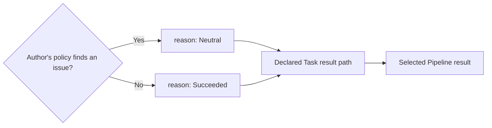

Inside a Task declaring an object result named `outcome`:

```sh
# Finding present:
printf '%s' '{"reason":"Neutral","message":"Review validation output."}' \
  > "$(results.outcome.path)"

# No finding:
printf '%s' '{"reason":"Succeeded","message":""}' \
  > "$(results.outcome.path)"
```

These are alternative writes, chosen by the author's policy. The proposed
selector requires controller implementation; underlying object-result feature
requirements still apply.

### Publication

Evaluate the report before publishing terminal success, in the same status
update. Consumers must never observe success first and receive neutral later.

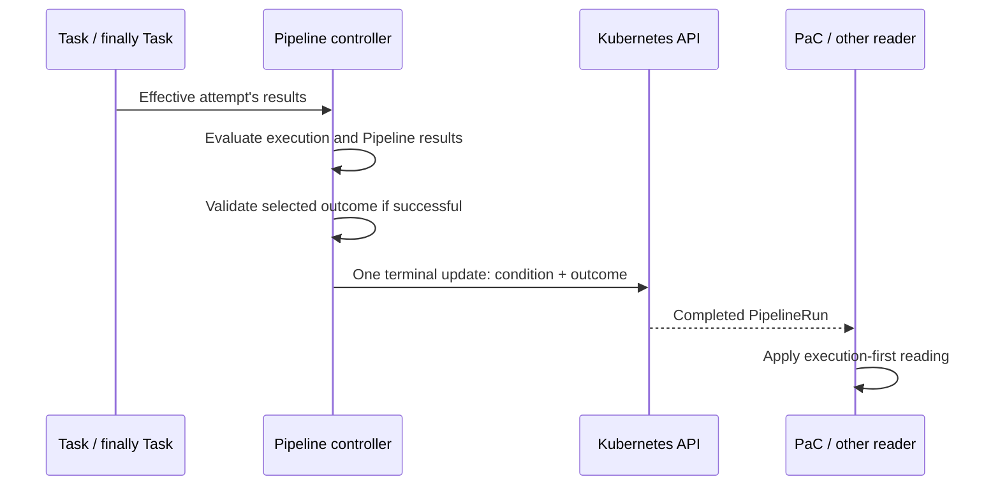

Reuse existing result collection. Retries, restarts, and repeated reconciliation
must produce the same effective outcome; abandoned attempts cannot supply it.

## Design Evaluation

The API adds a small result validation step without requiring another Pod,
service, or API request. Authors may add a summary Task when aggregation is needed.

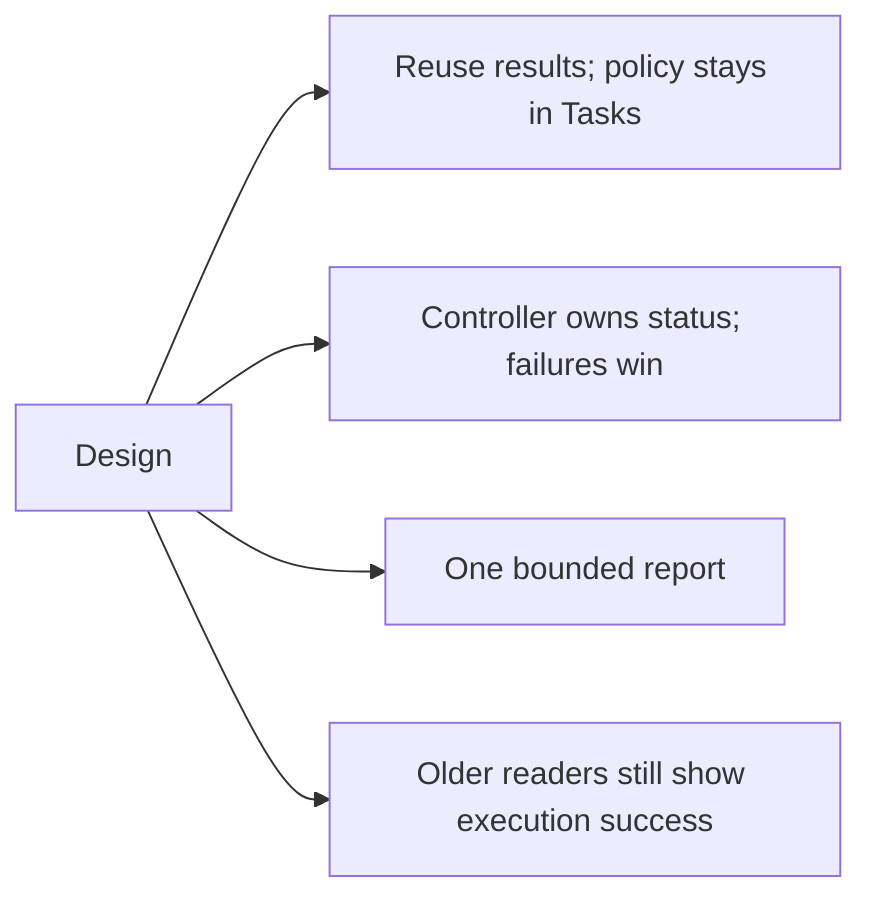

| Concern | Contract |
| --- | --- |
| Compatibility | Keep existing execution semantics; see [TEP-0151]. |
| Hidden findings | Missing selected reports fail visibly. |
| Security | No extra RBAC; escape messages and omit secrets. |
| Adoption | PaC, CLI, and dashboard must explicitly read the new field. |

## Alternatives and Open Questions

The meeting suggested using condition reason/message fields. This draft prefers
an additive outcome to preserve existing reasons; that choice is still open.

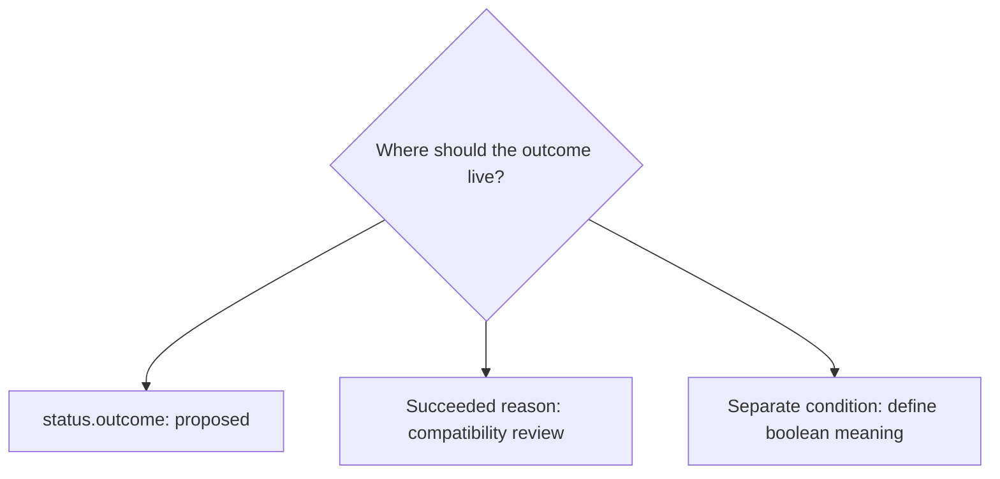

| Decision | Proposed answer / alternative |
| --- | --- |
| Producer API | Select an object result / bind reason and message directly. |
| Missing or invalid report | Fail visibly / define another visible error. |
| Names and bounds | Review enum, field names, and 4,096-byte message limit. |
| PaC-only interpretation | Avoid divergent meaning across consumers. |
| Direct status patch / special exit code | Avoid competing writers and mixing policy with process failure. |
| Annotations alone | Useful detail, but do not define a shared run outcome. |

## Implementation Plan

Agree the API first; introduce it behind a dedicated, disabled-by-default alpha
flag. No implementation PR exists yet.

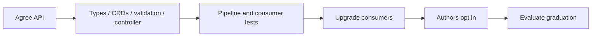

| Check | Required evidence |
| --- | --- |
| Compatibility and gate | No selector is unchanged; disabled feature rejects opt-in. |
| Validation | Embedded/resolved specs; types, enum, bounds, unknown keys, missing/skipped producer. |
| Precedence | Failures, cancellation, timeouts, final Tasks, ignored failures, skipped Tasks. |
| Publication | Effective retry results; one terminal update; restart/reconcile consistency. |
| End to end | Successful Tasks report neutral; PaC and another reader agree; also test success and conflicting failure. |

Update generated APIs and docs. Test using existing Pipeline and PaC infrastructure.
For downgrade, remove selectors and finish opted-in runs before replacing the
controller. Further outcomes and TaskRun reporting require follow-up proposals.

## References

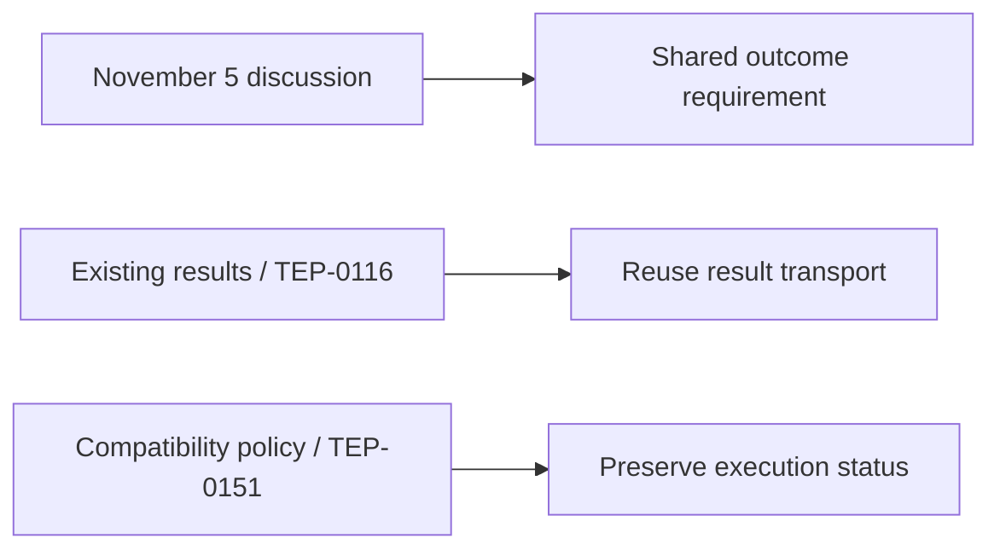

- November 5, 2026 discussion, summarized from meeting notes; a public meeting
  or ADR link remains to be added. [PaC #1235][pac-results] is related discussion.
- [TEP process][tep-process] and [finally result propagation][TEP-0116].
- [Compatibility policy][compatibility] and [TEP-0151].
- [Pipeline results][pipeline-results] and [feature versioning][feature-versioning].
- Verified upstream [completion helpers][status-source] and [status publication][reconciler-source].

[pac-results]: https://github.com/tektoncd/pipelines-as-code/issues/1235
[tep-process]: https://github.com/tektoncd/community/blob/main/teps/0001-tekton-enhancement-proposal-process.md
[TEP-0116]: https://github.com/tektoncd/community/blob/main/teps/0116-referencing-finally-task-results-in-pipeline-results.md
[TEP-0151]: https://github.com/tektoncd/community/blob/main/teps/0151-error-attribution-via-condition-status.md
[compatibility]: https://github.com/tektoncd/pipeline/blob/main/api_compatibility_policy.md
[pipeline-results]: https://github.com/tektoncd/pipeline/blob/main/docs/pipelines.md#emitting-results-from-a-pipeline
[feature-versioning]: https://github.com/tektoncd/pipeline/blob/main/docs/developers/feature-versioning.md
[status-source]: https://github.com/tektoncd/pipeline/blob/2451916543955b4525bcafb09b3b3efde4cf0c6f/pkg/apis/pipeline/v1/pipelinerun_types.go#L78-L95
[reconciler-source]: https://github.com/tektoncd/pipeline/blob/2451916543955b4525bcafb09b3b3efde4cf0c6f/pkg/reconciler/pipelinerun/pipelinerun.go#L976-L1010
